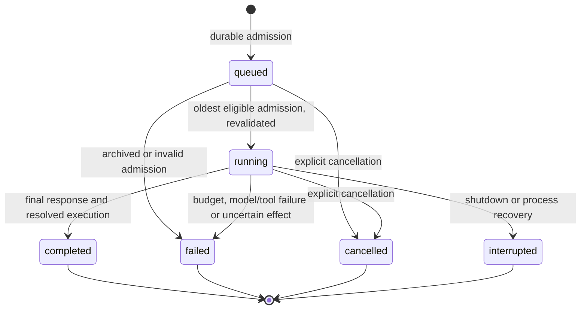

# Headless run contract

The run service connects the evidence store, prompt assembler, pinned model adapter
and permission dispatcher.

`compose(profile)` constructs one `ApplicationContext`; `await context.start()`
starts its resources and `await context.stop()` joins owned work before closing
clients and storage. `context.runs` is the application entry point:

```python
session = context.store.create_session(mode=profile.mode)
run = context.runs.submit(session.id, profile=profile, content="Hello", request_id=new_id())
outcome = await context.runs.wait(run.id, timeout=30)
```

Admission is synchronous on the owning event loop: it commits the run, frozen
profile, user input and queue position before returning. The caller supplies a
validated effective profile for the selected session mode and origin. The owning
runtime/model identity and current authority are checked. A repeated request key
with the same session/profile/origin/input returns the original run, even after
configuration changes or terminal completion; changed input conflicts. A retry
never gets a fresh authority ceiling through the same key. Low-level Store
methods remain available to maintenance/tests; application callers use this service.
Scheduled/proactive admission requires the atomic occurrence claims supplied by
`context.jobs`, rather than `runs.submit`; see the [job contract](jobs.md).
Interactive parents with `delegate.run` can admit isolated workers through the
dispatcher. See the [delegation contract](tools.md#bounded-delegation).

## State and evidence



Terminal state cannot transition again. Restart flushes the outbox, marks former
running work interrupted, and records unresolved tool intents as uncertain without
replaying them. Untouched queued admissions resume in their durable outbox order
and revalidate current configuration/session archival. Storage failures stop new
admission and cancel sibling work; a waiter receives a storage error. If an outcome
cannot be persisted, the stored run stays nonterminal until restart recovery.
There is no fabricated successful receipt to cover missing evidence.

Run requests disable thinking to reserve the output budget for actionable calls and
visible answers. The pinned adapter supports explicit thinking probes.
Each model request retains exact bytes/manifest before network access. Every reply
retains raw transport bytes and a normalized ModelStep. New steps also retain
provider tool IDs, function names and original argument strings. Old steps without
these optional fields stay readable. Tool intent/receipt durability and current
permissions remain the dispatcher's responsibility. Tool results get linked durable
messages; the combined status/effect/error/result rendering, including its marker,
is bounded by `tool_result_bytes`. A JSON envelope separates metadata from result
bytes and preserves whitespace such as a file's trailing newline. Full receipt and artifact provenance remain
inspectable independently of that rendering.

The next request projects assistant tool proposals and one matching provider-ID
result for each proposal. Malformed, undisclosed or unexecuted proposals are labelled
not executed; they are never represented as successful calls. Projected record IDs
are recorded in the manifest. Future queued user inputs never enter an active
turn's context. Previous started turns in the same topic are projected in order;
queued-cancelled turns are excluded. Ephemeral runs see only their own exchanges.
Compaction selects one active summary plus the later whole-turn tail, with two recent
turns preserved. Compaction happens under the same session owner before the first
conversation step. Context that cannot fit still fails visibly without silent
truncation; see the [context contract](context-compaction.md).

## Bounded concurrency and waits

The service has one queue coordinator and at most **8 active run tasks**, with at
most **64 pending admissions**. These are internal constructor defaults, not new
operator configuration. SQLite owns pending work; there is no permanent task or
lock for every historical session. Same-session turns are FIFO and only one owns
context at a time. Across sessions, the oldest eligible admission takes a free
slot; blocked sessions do not stop independent sessions. Recovered admissions are
retained even if an older installation admitted more than the current bound.

Interactive and internal background callers use the same FIFO policy, without
priority or reserved capacity. The adapter uses the application's single asyncio
inference semaphore; its waiters acquire in arrival order. A continuously active
run rejoins behind already waiting calls on its next model step. Tools and waits
hold the session slot but release the inference permit. Tests measure one concurrent
inference and a maximum eight-position interval between turns under mixed-origin
load. Compaction uses this same permit, run deadline and model-call budget.
The scheduler limits automatic scheduled/proactive work to one active run
and eight pending by default, with durable topic/hour/day admission caps. Interactive
work remains eligible in the other slots; the same FIFO inference permit is shared.

Delegation starts older eligible admissions before reserving an active slot for
the child. When the remaining slots are full, it reports busy before admitting
anything. One child may run per parent at a time. The parent waits outside the
inference permit, pays for the child's recorded model/tool attempts within its
remaining budgets, and reserves one model call to report back. The parent run
and tool deadlines include the child's runtime. A cancelled or timed-out parent
call settles its child before writing the receipt. Restart interrupts both running
children and children that were durably admitted but did not start.

A wait timeout, wait cancellation, or HTTP disconnection leaves admitted work running. A wait from within a tool
for work in the current session returns its current admission immediately; waiting
for that session's queued successor would otherwise deadlock. There are no event
subscriptions or per-waiter background workers to retain after disconnect.

`cancel` removes queued eligibility or signals an active model/tool task once.
Repeated cancellation does not interrupt receipt cleanup. Shutdown stops admission,
cancels active work as interrupted, joins tasks and preserves untouched queued work.
Explicitly cancelled work remains cancelled even during shutdown. Task callbacks
release session ownership and references, including repeated ephemeral sessions.
Handlers must cooperate with asyncio cancellation; the existing application shutdown
deadline retains process ownership if cleanup does not finish.

## Bounded recovery and honest completion

Model and tool budgets apply before each attempt; active elapsed time starts when
execution starts and includes inference waits. Queue wait is excluded. Current
budget reductions apply between attempts, while the admitted active deadline also
wraps the entire cycle. Tool dispatch retains its own per-call/active deadline and
current-authority checks.

There is at most one recovery of **each** kind per run:

- Argument repair: a complete, identifiable batch with malformed JSON executes
  nothing and gets corrective feedback. Schema-invalid dispatches keep their
  failed receipts. Rejected tool names must subsequently succeed before completion.
- Schema disclosure: the evaluation-only deferred mode initially supplies an
  authorized name catalog. An identifiable eligible hidden call discloses schemas
  and executes nothing from that batch; the next call must be complete. Disclosure
  cannot grant access. Production composition always starts eager.
- Narration continuation: conservative English imperative matching identifies
  explicit requested file/tool work. If it remains unattempted, an authorized tool
  gets one continuation opportunity. An unresolved continuation fails, including a
  repeated promise or a later refusal. Quotes, hypothetical questions, explanations,
  and ordinary requests to write prose are covered by negative tests.
  `check` and `inspect` do not imply a runtime status request; explicit status-tool
  names still match through the normal tool-name rule.

A RecoveryNote links each decision to its original ModelStep. Its instructions and
all original replies/arguments remain evidence. The detector is intentionally
bounded and lexical, not a semantic proof that arbitrary requested work was done;
new phrasing must be evaluated before expanding it. A successful tool may still
produce incorrect content: corpus scoring inspects actual artifacts and every effect.

An uncertain effect immediately fails the run and stops further model/tool work.
Other tool failures/denials and refusals leaving requested work unexecuted remain
a failed run even if the model produces a final answer. A schema/argument repair may resolve invalid input; optional memory
unavailability may yield a completed degraded conversation with its failure receipt.
The memory service supplies recorded recall once at run start and extracts memory
asynchronously after completion. Profiles requiring memory fail before inference
when recall is unavailable. See the [memory contract](memory.md). No model transport retry or uncertain
non-idempotent retry is added. A model's deliberate repeated valid effect requests
are still observable effects, not an exactly-once guarantee; the evaluator rejects
duplicates and incorrect intermediate writes even if the final artifact is correct.
